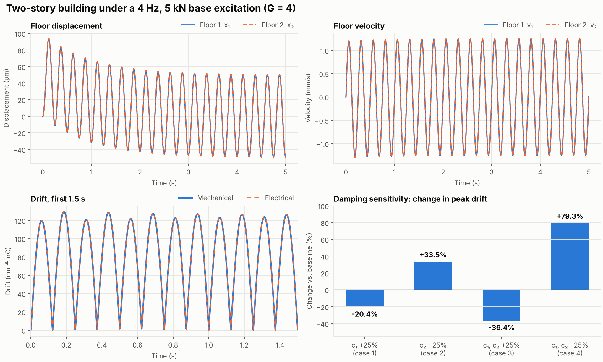
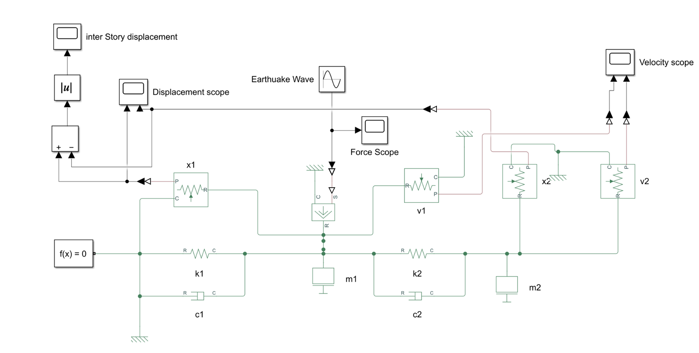
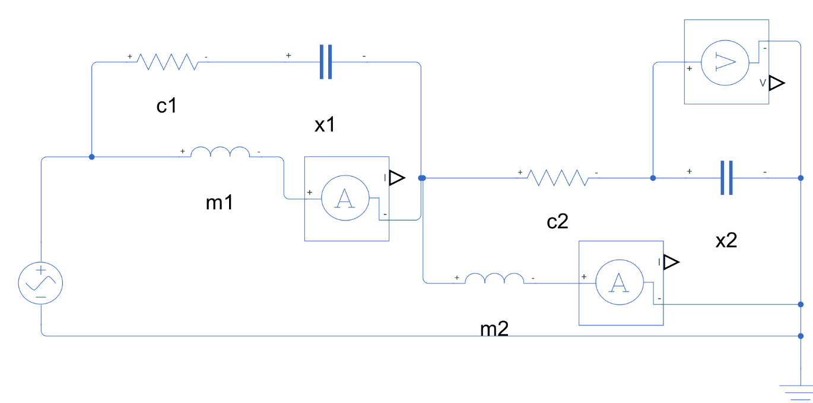
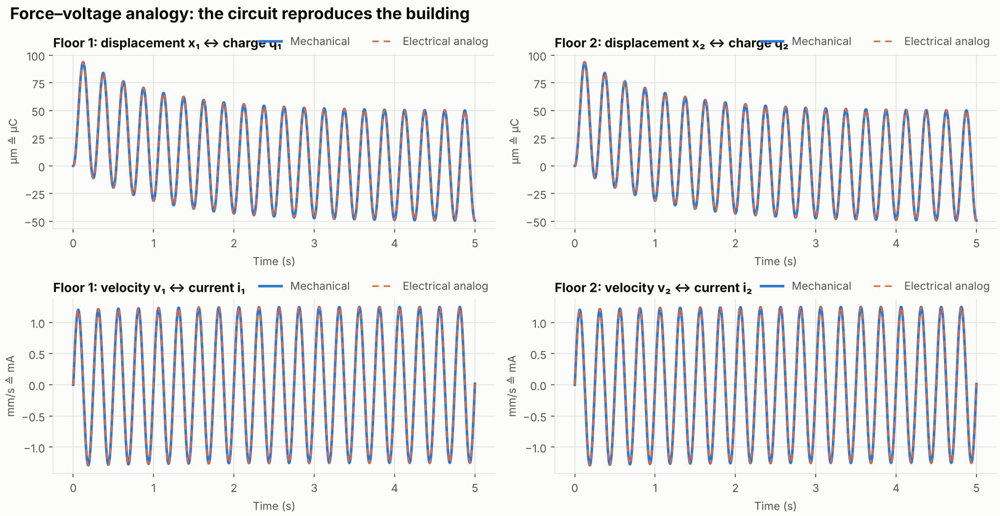
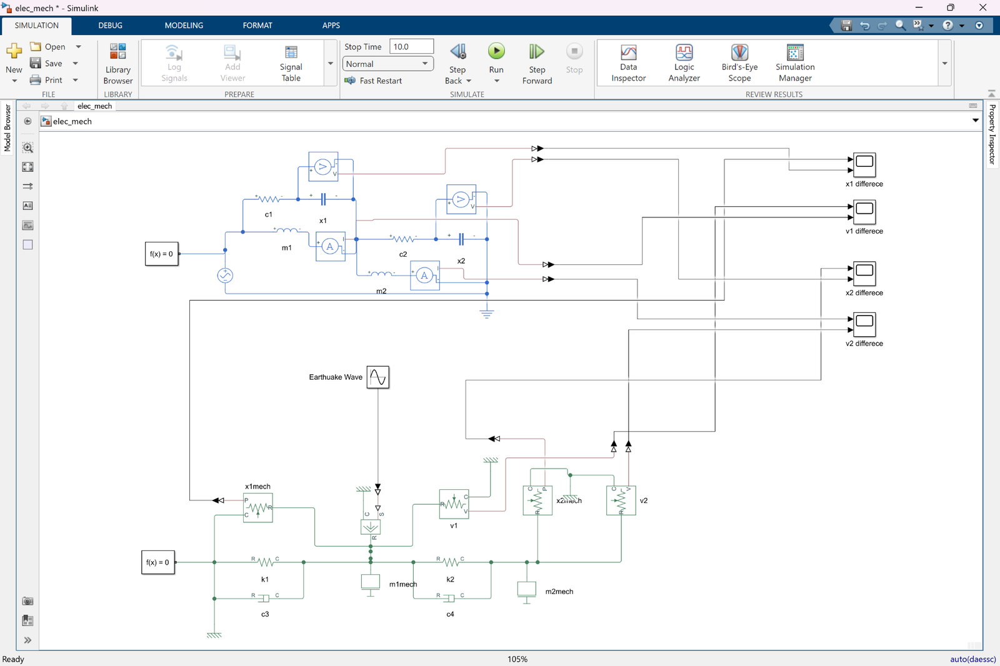
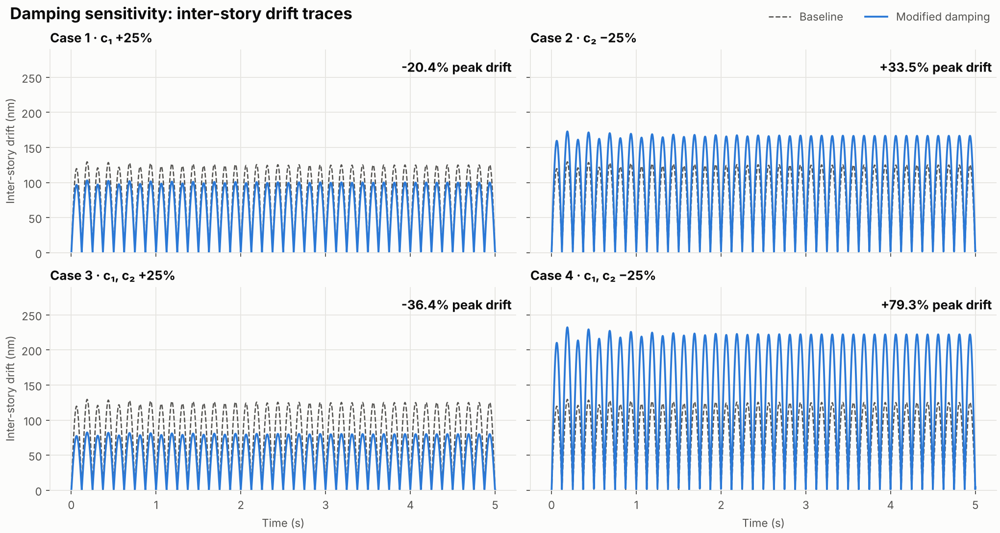
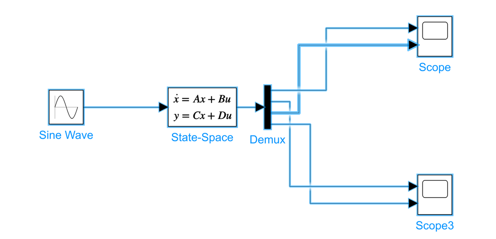
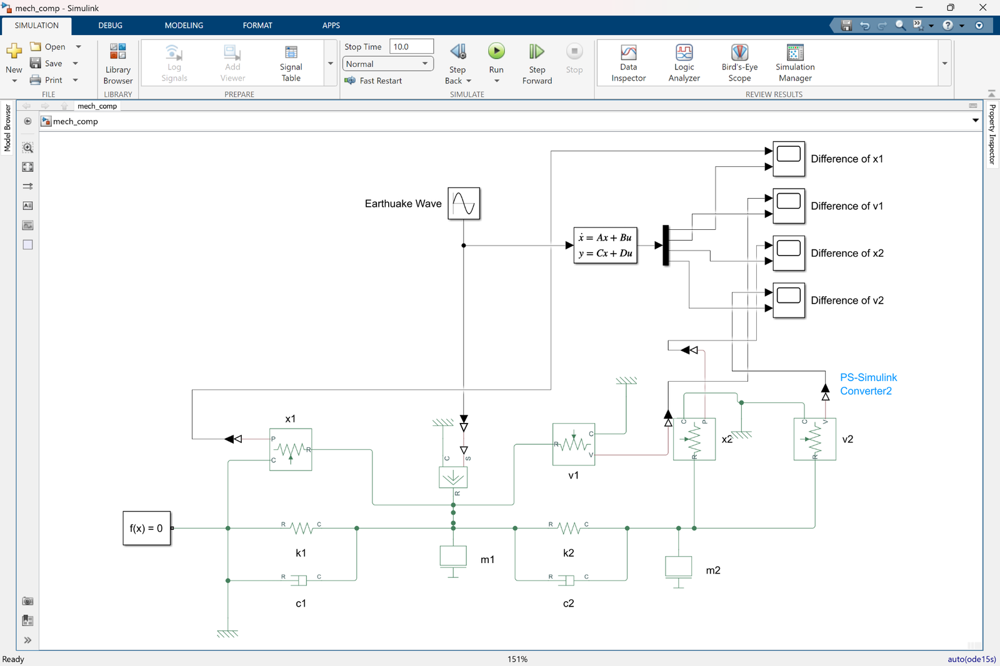
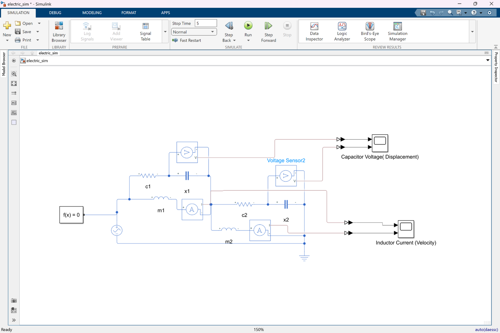
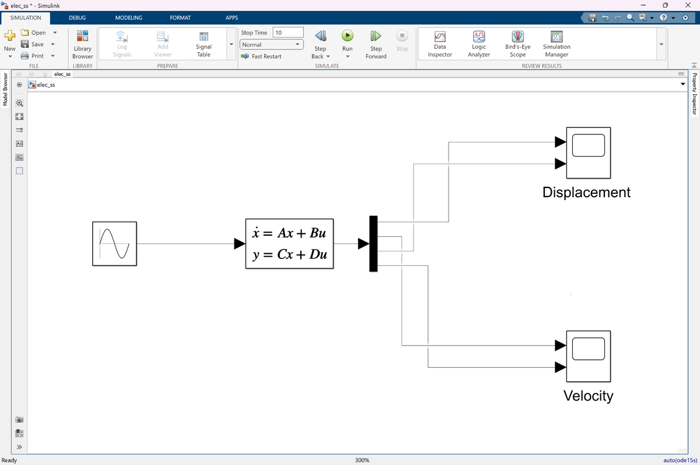

# Quake-in-a-Circuit

### A two-story building's earthquake response, rebuilt as an RLC circuit and cross-checked three ways

What does a shaking building have in common with a capacitor? The same differential equation. This project models a two-story building under sinusoidal earthquake loading as a lumped mass–spring–damper system, rebuilds it as an electrical circuit with the **force–voltage analogy** (masses → inductors, dampers → resistors, springs → capacitors), and shows that both produce the same motion. Everything is implemented in MATLAB/Simulink (Simscape and Simscape Electrical), validated against hand-derived state-space models, re-checked independently in Python, and finished with a damping sensitivity study.

This repository contains models, scripts, figures and results. The written report is maintained separately and is not included here.

---

## Results at a glance



*Top: floor displacement and velocity under a 5 kN, 4 Hz excitation. Bottom left: inter-story drift of the building and of its electrical analog, which overlap. Bottom right: how peak drift changes when the dampers are made 25% stronger or weaker.*

### The building and its circuit



*Mechanical model in Simscape: two masses (floors), two springs, two dampers and an ideal force source acting on floor 1.*



*Electrical analog in Simscape Electrical: inductors m₁ and m₂ are the floors, each R–C pair (c₁/k₁, c₂/k₂) is a damper and spring, and the AC source plays the earthquake. Floor velocity is read as inductor current.*

### Building vs. circuit



*Displacement ↔ capacitor charge and velocity ↔ inductor current, overlaid for both floors.*



*Comparison model: building and circuit driven by the same source, with difference scopes for x₁, v₁, x₂ and v₂.*

### Damping sensitivity



*Peak inter-story drift for each damping variation, plotted against the baseline.*

| Quantity (G = 4) | Value |
|---|---:|
| Peak floor displacement (both floors) | 93.7 µm |
| Settled displacement amplitude (t ≥ 3 s) | 51.9 µm |
| Peak floor velocity | 1.29 mm/s |
| Peak inter-story drift | 0.130 µm |
| Simscape vs. state-space mismatch (mechanical) | ~10⁻²⁰ m (solver round-off) |
| State-space vs. independent second-order solve (Python) | 0.005 % |
| c₁ +25 % | **−20.4 %** drift |
| c₂ −25 % | **+33.5 %** drift |
| c₁ and c₂ +25 % | **−36.4 %** drift |
| c₁ and c₂ −25 % | **+79.3 %** drift |

The sensitivity percentages come from the MATLAB script and were reproduced exactly in Python ([`results/metrics.md`](results/metrics.md)). The Simscape-versus-state-space differences are read from the original Simulink runs (screenshots in [`results/simulink/`](results/simulink/)); the Python check re-solves the equations independently. The zero mismatch between the mechanical and electrical state-space models holds by construction. See [`docs/findings.md`](docs/findings.md) for what that does and does not prove.

---

<!-- gallery:start -->
### All Simulink models

<table>
<tr><td align="center" width="50%"><br><sub>Mechanical model as a state-space block</sub></td><td align="center" width="50%"><br><sub>Mechanical Simscape model vs. state-space block</sub></td></tr>
<tr><td align="center" width="50%"><br><sub>Electrical Simscape circuit with sensors</sub></td><td align="center" width="50%"><br><sub>Electrical circuit as a state-space block</sub></td></tr>
</table>

<!-- gallery:end -->

## The idea: force–voltage analogy

Newton's second law for a floor and Kirchhoff's voltage law for a series RLC mesh have the same form, so each mechanical quantity has an electrical twin:

| Mechanical | Symbol | Electrical | Symbol |
|---|:-:|---|:-:|
| Force (earthquake) | F(t) | Voltage source | V(t) |
| Velocity | ẋ | Current | i |
| Displacement | x | Charge | q |
| Mass | m | Inductance | L = m |
| Damping coefficient | c | Resistance | R = c |
| Spring stiffness | k | Inverse capacitance | 1/C = k |

Components that share a velocity (a spring and damper on the same floor) share a current, so they sit in series in the circuit.

## Model parameters

All values are scaled by a single parameter, **G = 4**. The excitation is F(t) = 5000 sin(2πG t) N, i.e. 4 Hz.

| Parameter | Formula | Value | Electrical twin | Value |
|---|---|---:|---|---:|
| m₁ | 1000·G | 4000 kg | L₁ | 4000 H |
| m₂ | 800/G | 200 kg | L₂ | 200 H |
| k₁ | 10⁶·G | 4×10⁶ N/m | C₁ = 1/k₁ | 0.25 µF |
| k₂ | 0.8×10⁶/G | 2×10⁵ N/m | C₂ = 1/k₂ | 5 µF |
| c₁ | 10⁶·G | 4×10⁶ N·s/m | R₁ | 4 MΩ |
| c₂ | 8×10⁶/G | 2×10⁶ N·s/m | R₂ | 2 MΩ |

## Governing equations

With floor displacements x₁, x₂ measured from the fixed ground:

```
m₁ x₁'' + (c₁+c₂) x₁' − c₂ x₂' + (k₁+k₂) x₁ − k₂ x₂ = F(t)
m₂ x₂'' + c₂ x₂'  − c₂ x₁'  + k₂ x₂  − k₂ x₁  = 0
```

State vector z = [x₁, ẋ₁, x₂, ẋ₂]ᵀ, giving ż = Az + Bu with

```
A = [      0          1        0         0
    −(k₁+k₂)/m₁  −(c₁+c₂)/m₁  k₂/m₁   c₂/m₁
           0          0        0         1
        k₂/m₂       c₂/m₂   −k₂/m₂  −c₂/m₂ ]      B = [0, 1/m₁, 0, 0]ᵀ
```

For G = 4 this is `A = [0 1 0 0; −1050 −1500 50 500; 0 0 0 1; 1000 10000 −1000 −10000]`, `B = [0; 0.00025; 0; 0]`. The electrical model has the same structure with L, R and 1/C in place of m, c and k. The full derivation is in [`docs/derivation.md`](docs/derivation.md).

---

## Model suite

| File | What it is |
|---|---|
| [`models/mech_sim.slx`](models/mech_sim.slx) | Mechanical building in Simscape |
| [`models/mech_state.slx`](models/mech_state.slx) | Mechanical state-space block diagram |
| [`models/mech_comp.slx`](models/mech_comp.slx) | Simscape vs. state-space, with difference scopes |
| [`models/electric_sim.slx`](models/electric_sim.slx) | Electrical analog in Simscape Electrical |
| [`models/elec_ss.slx`](models/elec_ss.slx) | Electrical state-space block diagram |
| [`models/elec_comp.slx`](models/elec_comp.slx) | Electrical Simscape vs. state-space, with difference scopes |
| [`models/elec_mech.slx`](models/elec_mech.slx) | Building and circuit side by side, with difference scopes |

| Script | What it does |
|---|---|
| [`matlab/mechanical_state_space.m`](matlab/mechanical_state_space.m) | Mechanical state-space response, drift and plots |
| [`matlab/electrical_state_space.m`](matlab/electrical_state_space.m) | Electrical state-space response and drift |
| [`matlab/building_vs_circuit.m`](matlab/building_vs_circuit.m) | Overlays building and circuit, prints errors |
| [`matlab/damping_sensitivity.m`](matlab/damping_sensitivity.m) | The four damping variations (±25 %) |
| [`python/verify_and_plot.py`](python/verify_and_plot.py) | Independent re-check and regenerates every figure in `results/figures/` |

More Simulink screenshots (state-space block diagrams, Simscape-vs-state-space comparison) are in [`results/simulink/`](results/simulink/).

---

## Repository layout

```
models/   7 Simulink models (Simscape, Simscape Electrical, state-space, comparison)
matlab/   4 MATLAB scripts (state-space simulations and sensitivity study)
python/   independent verification and figure generation
results/  figures, Simulink screenshots, computed metrics
docs/     derivation notes, findings and known limitations
```

## Toolchain

| Purpose | Tool |
|---|---|
| Modelling and simulation | MATLAB / Simulink R2023a |
| Mechanical and electrical physical modelling | Simscape, Simscape Electrical |
| State-space simulation | Control System Toolbox (`ss`, `lsim`) |
| Independent verification | Python 3 with NumPy, SciPy, Matplotlib |

## Running it

**MATLAB / Simulink.** Open any `.slx` in `models/` and press Run (stop time is set inside each model). The scripts in `matlab/` are standalone: run them from the MATLAB prompt.

```matlab
cd matlab
mechanical_state_space
damping_sensitivity
building_vs_circuit
```

**Python (no MATLAB needed).**

```bash
pip install -r python/requirements.txt
python python/verify_and_plot.py
```

This prints the peak values, the model-to-model residuals and the sensitivity table, writes `results/metrics.md`, and regenerates the three PNGs in `results/figures/`.

---

## Status

- [`results/metrics.md`](results/metrics.md): numbers generated by the Python check.
- [`docs/derivation.md`](docs/derivation.md): free-body equations, state-space matrices, electrical mesh equations.
- [`docs/findings.md`](docs/findings.md): what the checks prove, unit notes and known limitations.

## Contributors

Raihana, Hamim, Intisar and Yeasin.

## License

Released under the MIT License. See [`LICENSE`](LICENSE).
